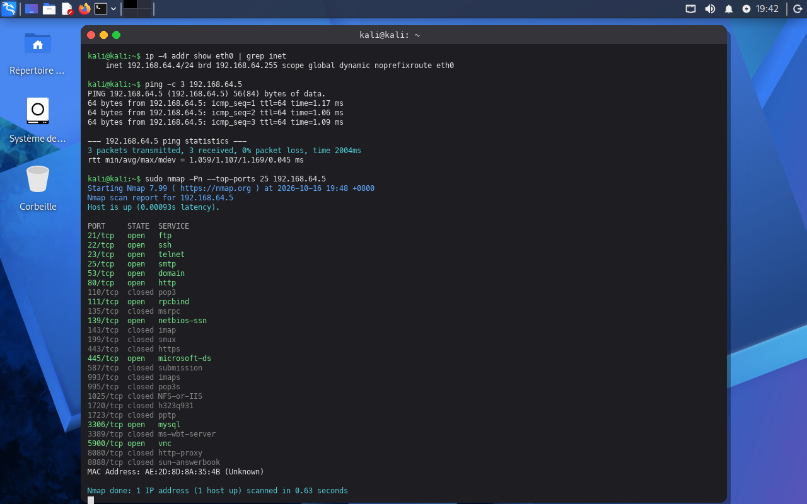

# Project: Nmap Service Scan

## Objective
Confirm the target is reachable and enumerate the services it exposes, then turn
that reconnaissance into defensive observations. Scanning was done **only** against
a machine I own in my isolated lab.

## Environment and tools
- Attacker: Kali Linux VM (`192.168.64.4`)
- Target: Metasploitable 2 VM (`192.168.64.5`) - see [Virtual Lab Setup](../virtual-lab-setup/)
- Tool: Nmap 7.99
- Network: private UTM subnet `192.168.64.0/24`

## Method (step by step)
1. **Check my own address:** `ip -4 addr show eth0` -> Kali is `192.168.64.4`.
2. **Confirm the target is up:** `ping -c 3 192.168.64.5` -> 3/3 replies, 0% loss.
3. **Port scan:** `sudo nmap -Pn --top-ports 25 192.168.64.5` to list the state of
   the 25 most common TCP ports on the target.
4. Reviewed each open service and noted which ones look risky.

## Results
- The target answered the ping (host is up), confirming connectivity.
- The scan reported many open services on Metasploitable 2, including
  `21/ftp`, `22/ssh`, `23/telnet`, `25/smtp`, `53/domain`, `80/http`,
  `111/rpcbind`, `139/netbios-ssn`, `445/microsoft-ds`, `3306/mysql` and `5900/vnc`.
- That is a very large attack surface: legacy, cleartext services such as telnet
  and FTP stand out immediately as the first things an attacker would target.

### Evidence

*Full terminal session: `ip addr` (Kali is `192.168.64.4`), the successful `ping` to `192.168.64.5`, and the Nmap output listing the open ports.*

## Defensive takeaway / what I would do differently
- Every open service is attack surface: close or firewall anything not needed, and
  replace cleartext services (telnet, FTP) with encrypted equivalents (SSH, SFTP).
- Keep exposed services patched, since old versions are what attackers look for.
- From the defender's side, this kind of scan is noisy and would be visible to an
  IDS, which is a good reason to monitor for sweeps and port scans.
- Next time I would add `-sV` for service/version detection to see exactly which
  builds are running.
