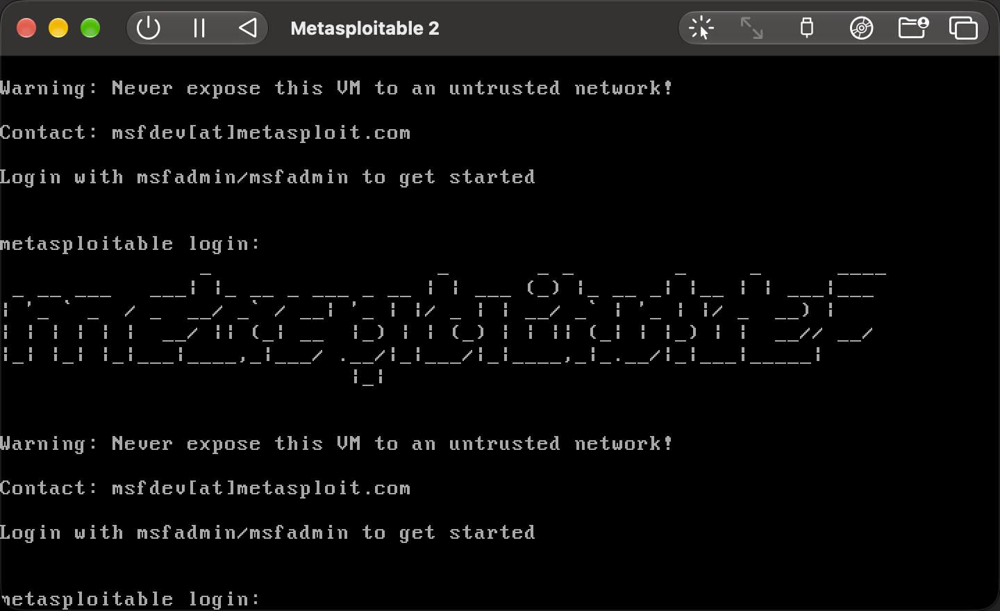
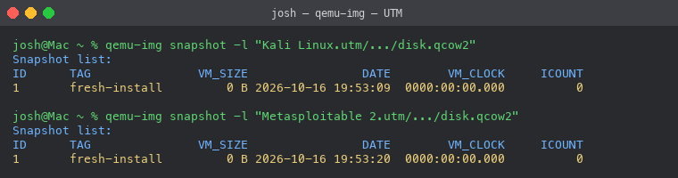

# Project: Virtual Lab Setup

## Objective
Build an isolated virtual lab where I can practise reconnaissance and other
techniques safely and legally, without touching any production or third-party
system. The lab had to let an "attacker" machine and a "target" machine talk to
each other on a private network.

## Environment and tools
- Host: my MacBook (macOS)
- Hypervisor: **UTM** (QEMU based)
- Attacker VM: Kali Linux
- Target VM: Metasploitable 2 (a deliberately vulnerable learning VM)
- Networking: both VMs on the same private subnet (`192.168.64.0/24`)

## Method (step by step)
1. Installed UTM and created the two VMs (Kali and Metasploitable 2).
2. Booted the Metasploitable 2 target and reached its login prompt.
3. Took a clean **`fresh-install` snapshot** of each VM with `qemu-img`, so I can
   roll back to a known-good state between exercises.
4. Booted Kali and confirmed both machines were on the same private subnet.
5. Verified connectivity from the attacker to the target with `ping`.

## Results
- Both VMs run and sit on the same private subnet, able to reach each other.
- Each VM has a clean `fresh-install` snapshot to roll back to.
- This lab is the base used for the [Nmap Service Scan](../nmap-service-scan/) project.

### Evidence

*The Metasploitable 2 target VM running in UTM, at its login prompt.*

*`qemu-img snapshot -l` showing the clean `fresh-install` snapshot on both the Kali and Metasploitable 2 VMs.*

## What I would do differently
- Add a third VM running a simple IDS (for example Suricata) to see the same
  activity from the defender's point of view.
- Document the exact UTM network mode in the repo so the lab is fully reproducible.
